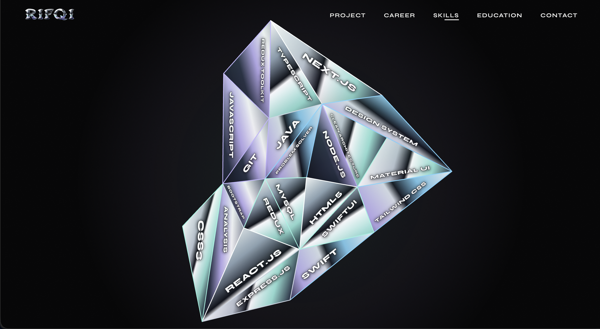

# RIFQI ZIYAD IMTINAN — Frontend Developer Portfolio



> Minimalist, brutalist, and performance-oriented personal developer portfolio with **Monolith Architectural Grid** and **3D Chiseled Horizon Liquid Chrome** design system, sticky horizontal parallax showcases, modular architecture, and 60fps buttery-smooth motion.

---

## 🌐 Live Website

- **Production URL**: [https://rifqiziyad.github.io](https://rifqiziyad.github.io)

---

## 🎨 Design System & Guidelines

All interface components, color tokens, typography rules, layer contracts (`z-index`), and new page templates are documented in:

👉 **[`docs/design.md`](docs/design.md)** — *Single Source of Truth for Design & UI Components*.

Whenever adding a new section or page, refer to that document to ensure strict visual harmony with the **Monolith Architectural Grid** and **3D Chiseled Horizon Liquid Chrome** design system.

---

## ✨ Key Features

- **Monolith Architectural Grid & 3D Horizon Liquid Chrome**: Strict, hairline 1px grid layout inspired by modern brutalist and Swiss typography, combined with high-contrast horizon mirror chrome reflections and subtle icy mint (`#99f6e4`) & lavender (`#c4b5fd`) iridescent refractions.
- **Interactive 3D Crystal Monoliths**: Pure facet crystalline SVG structures for Skills (`#skillsCrystalStage`) and Contact background (`#bgContactCrystal`) with zero visual clutter (clean surfaces without laser fracture lines or glow nodes).
- **Horizontal Sticky Project Showcase**: Custom pinning, continuous continuous index tracking, and dual-layer lit/dim spotlight typography powered by GSAP ScrollTrigger & Lenis.
- **Synchronized Responsive Viewport**: Dual desktop and mobile controllers (`project-showcase.js` and `project-mobile.js`) with responsive subpixel alignment.
- **Architectural Carousel Modal**: Parallax-wipe transitions, mixed aspect ratio gallery support (`object-fit: contain`), FLIP morph crop transitions, and full keyboard/touch swipe controls.
- **Image Skeleton Fallback**: Lightweight dark shimmer skeleton loading states across all profile photos, showcases, and modal thumbnails without external dependencies.
- **Production Asset Pipeline**: Custom bundling with `esbuild` for minified CSS and code-split JS chunks (`chunk-carousel`).
- **High Accessibility & SEO**: Semantic HTML5, JSON-LD structured data, Open Graph / Twitter cards, keyboard focus traps, and WCAG reduced-motion compliance.

---

## 🛠️ Tech Stack

- **Core**: Vanilla Modern JavaScript (ES2022+ / Modular Architecture), HTML5, CSS3 Variables & Modern Grid / Flexbox
- **Animations & Smooth Scroll**: [GSAP (GreenSock)](https://greensock.com/gsap/) with [ScrollTrigger](https://greensock.com/scrolltrigger/), [@studio-freight/lenis](https://github.com/darkroomengineering/lenis)
- **Bundler & Build Tooling**: Node.js, [esbuild](https://esbuild.github.io/)
- **Typography**: Space Grotesk, Syne, Inter (Self-hosted variable WOFF2 fonts)
- **Deployment & CI/CD**: GitHub Actions, GitHub Pages

---

## 🚀 Getting Started

### Prerequisites

- [Node.js](https://nodejs.org/) (version 18+ or 20+ recommended)
- `npm`

### Installation & Setup

1. **Clone the repository**:
   ```bash
   git clone https://github.com/rifqiziyad/rifqiziyad.github.io.git
   cd rifqiziyad.github.io
   ```

2. **Install dependencies**:
   ```bash
   npm install
   ```

3. **Development Preview**:
   You can open `index.html` directly in any browser (fully compatible with `file://` protocol) or use any local HTTP server:
   ```bash
   npx serve .
   ```

4. **Production Build**:
   Builds minified bundles, asset copies, and chunk files into the `./build` folder:
   ```bash
   npm run build
   ```

---

## 📁 Project Structure

```text
├── .github/
│   └── workflows/
│       └── deploy.yml          # GitHub Pages automated CI/CD deployment
├── assets/                     # Optimized images, project mockups, fonts, and preview assets
│   ├── logo.svg                # 3D Chiseled Horizon Liquid Chrome RIFQI brand mark
│   ├── fonts/                  # Self-hosted variable WOFF2 fonts
│   └── ...                     # Project showcase assets
├── css/                        # Modular stylesheet architecture (15 CSS modules)
│   ├── variables.css           # Design tokens, chrome gradients, and timing functions
│   ├── global.css              # Reset, skeleton, typography, and utility classes
│   ├── header.css              # Site navigation & brand mark
│   ├── hero.css                # Editorial hero layout & profile portrait
│   ├── portfolio.css           # Desktop horizontal sticky showcase styling
│   ├── portfolio-mobile.css    # Dedicated mobile touch horizontal carousel
│   ├── carousel.css            # Architectural modal gallery styling
│   ├── career.css              # Monochrome shared timeline table styling
│   ├── skills.css              # Interactive 3D crystal monolith styling
│   ├── contact.css             # Contact bento grid & crystal background
│   └── ...                     # Cursor, preloader, education, footer styles
├── data/
│   └── portfolio-data.js       # Structured data source for projects, career, skills, and education
├── docs/                       # Project documentation & design system specs
│   └── design.md               # Design System Specification & Component Guidelines
├── js/
│   ├── animations/             # GSAP & Lenis animation orchestration controllers
│   ├── components/             # Reusable interactive components (carousel, preloader, navigation)
│   ├── core/                   # Shared rendering utilities and scroll manager
│   ├── renderers/              # Dynamic DOM injection modules
│   └── main.js                 # Application bootstrap and initialization
├── scripts/
│   └── build-assets.mjs        # Production esbuild & static asset pipeline script
├── index.html                  # Main markup entry point
├── package.json
└── README.md
```

---

## 👤 Author

**Rifqi Ziyad Imtinan**
- **Website**: [https://rifqiziyad.github.io](https://rifqiziyad.github.io)
- **GitHub**: [@rifqiziyad](https://github.com/rifqiziyad)

---

## 📄 License

This project is open source and available under the [MIT License](LICENSE).
