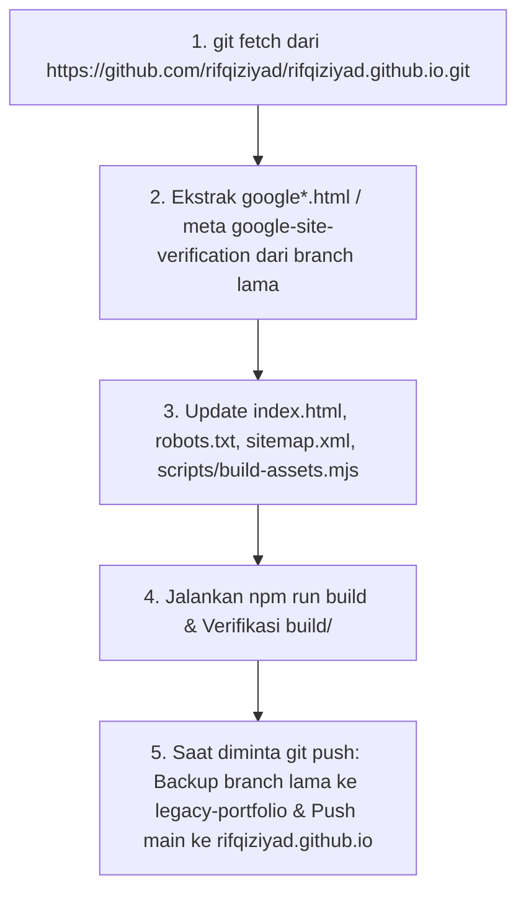

# Migrasi Repository ke Root Domain `https://rifqiziyad.github.io/` (Preservasi GSC & SEO)

## Goal Description
Memigrasikan repository `portfolio-minimalism` ini ke repository produksi utama **`rifqiziyad/rifqiziyad.github.io`** (`https://rifqiziyad.github.io/`) yang sudah terindeks oleh Google dan terverifikasi di **Google Search Console (GSC)**, tanpa memutus status verifikasi GSC maupun indeksasi SEO yang sudah berjalan.

---

## User Review Required

> [!IMPORTANT]
> **Otomatisasi Ekstraksi Verifikasi Google Search Console (GSC) & Backup Repo Lama**
> Karena `https://rifqiziyad.github.io/` sudah memiliki verifikasi GSC, saat eksekusi nanti kita akan:
> 1. Menambahkan remote ke `https://github.com/rifqiziyad/rifqiziyad.github.io.git` dan melakukan `git fetch`.
> 2. **Mengekstrak otomatis token GSC** dari branch lama (`google*.html` dan/atau `<meta name="google-site-verification" ...>` di `index.html` lama) lalu menyertakannya ke dalam repo baru ini serta ke `build/`.
> 3. **Membuat branch backup `legacy-portfolio`** di repo `rifqiziyad/rifqiziyad.github.io` agar kode web portfolio lama tetap tersimpan aman di GitHub.

---

## Proposed Changes

### 1. Ekstraksi Otomatis Verifikasi Google Search Console (GSC) dari Repo Lama

Saat tahapan migrasi dijalankan:
- Fetch branch aktif dari `https://github.com/rifqiziyad/rifqiziyad.github.io.git`.
- Cek apakah di branch lama terdapat:
  - File **`google*.html`** (metode HTML file upload GSC) → jika ada, checkout/salin file tersebut ke root repo ini.
  - Tag **`<meta name="google-site-verification" content="...">`** di `index.html` lama → jika ada, sisipkan tag `<meta>` yang sama persis ke `<head>` [`index.html`](../index.html).

---

### 2. Pembaruan URL SEO, Canonical, Open Graph, Twitter Card & JSON-LD

#### [MODIFY] [index.html](../index.html)
Mengubah seluruh 7 referensi URL dari `https://rifqiziyad.github.io/portfolio-minimalism/` menjadi root domain `https://rifqiziyad.github.io/`:

```diff
-  <link rel="canonical" href="https://rifqiziyad.github.io/portfolio-minimalism/">
+  <link rel="canonical" href="https://rifqiziyad.github.io/">

   <!-- Open Graph & Twitter Card Metadata -->
   <meta property="og:type" content="website">
   <meta property="og:title" content="RIFQI ZIYAD IMTINAN — Frontend Developer">
   <meta property="og:description"
     content="Personal portfolio of Rifqi Ziyad Imtinan. Frontend Developer with 4 years of experience building internal banking systems and customer-facing platforms.">
-  <meta property="og:url" content="https://rifqiziyad.github.io/portfolio-minimalism/">
-  <meta property="og:image" content="https://rifqiziyad.github.io/portfolio-minimalism/assets/my-photo.webp">
+  <meta property="og:url" content="https://rifqiziyad.github.io/">
+  <meta property="og:image" content="https://rifqiziyad.github.io/assets/my-photo.webp">

   <meta name="twitter:card" content="summary_large_image">
   <meta name="twitter:title" content="RIFQI ZIYAD IMTINAN — Frontend Developer">
   <meta name="twitter:description"
     content="Personal portfolio of Rifqi Ziyad Imtinan. Frontend Developer with 4 years of experience building internal banking systems and customer-facing platforms.">
-  <meta name="twitter:image" content="https://rifqiziyad.github.io/portfolio-minimalism/assets/my-photo.webp">
+  <meta name="twitter:image" content="https://rifqiziyad.github.io/assets/my-photo.webp">
```

Serta pada blok JSON-LD (`@graph` `WebSite` dan `Person`):

```diff
       {
         "@type": "WebSite",
         "name": "Rifqi Ziyad Imtinan — Frontend Developer Portfolio",
-        "url": "https://rifqiziyad.github.io/portfolio-minimalism/"
+        "url": "https://rifqiziyad.github.io/"
       },
       {
         "@type": "Person",
         "name": "Rifqi Ziyad Imtinan",
         "jobTitle": "Frontend Developer",
-        "url": "https://rifqiziyad.github.io/portfolio-minimalism/",
-        "image": "https://rifqiziyad.github.io/portfolio-minimalism/assets/my-photo.webp",
+        "url": "https://rifqiziyad.github.io/",
+        "image": "https://rifqiziyad.github.io/assets/my-photo.webp",
```

---

### 3. Sitemap & Robots.txt untuk Google Search Console

#### [MODIFY] [robots.txt](../robots.txt)
```diff
 User-agent: *
 Allow: /
 
-Sitemap: https://rifqiziyad.github.io/portfolio-minimalism/sitemap.xml
+Sitemap: https://rifqiziyad.github.io/sitemap.xml
```

#### [MODIFY] [sitemap.xml](../sitemap.xml)
```diff
 <?xml version="1.0" encoding="UTF-8"?>
 <urlset xmlns="http://www.sitemaps.org/schemas/sitemap/0.9">
   <url>
-    <loc>https://rifqiziyad.github.io/portfolio-minimalism/</loc>
+    <loc>https://rifqiziyad.github.io/</loc>
     <changefreq>monthly</changefreq>
     <priority>1.0</priority>
   </url>
 </urlset>
```

---

### 4. Build Pipeline Support untuk File Verifikasi GSC (`google*.html`)

#### [MODIFY] [scripts/build-assets.mjs](../scripts/build-assets.mjs)
Perbarui `copyStaticFiles()` agar otomatis menyalin file verifikasi `google*.html` (jika ada di root) ke dalam direktori `build/` setiap kali `npm run build` dijalankan di lokal maupun di GitHub Actions:

```diff
 function copyStaticFiles() {
   copyDirRecursive(path.join(ROOT_DIR, 'assets'), path.join(BUILD_DIR, 'assets'));
 
   for (const file of ['robots.txt', 'sitemap.xml']) {
     const src = path.join(ROOT_DIR, file);
     if (fs.existsSync(src)) {
       fs.copyFileSync(src, path.join(BUILD_DIR, file));
     }
   }
+
+  for (const entry of fs.readdirSync(ROOT_DIR, { withFileTypes: true })) {
+    if (entry.isFile() && /^google[a-z0-9]+\.html$/i.test(entry.name)) {
+      fs.copyFileSync(path.join(ROOT_DIR, entry.name), path.join(BUILD_DIR, entry.name));
+    }
+  }
 }
```

---

### 5. Alur Eksekusi Migrasi Git



---

## Verification Plan

### Automated Verification
1. Verifikasi file/meta GSC dari repo `rifqiziyad.github.io` lama berhasil disalin (jika ada di git tree lama).
2. Jalankan `npm run build` dan pastikan `build/index.html`, `build/robots.txt`, `build/sitemap.xml` (serta `build/google*.html` bila ada) ter-build dengan bersih.
3. Jalankan `grep -rn "portfolio-minimalism" index.html robots.txt sitemap.xml build/` untuk memastikan **0** referensi URL subpath tersisa pada file produksi.

### Manual Verification (Pasca-Deploy)
1. Pastikan di GitHub repo `rifqiziyad/rifqiziyad.github.io` menu **Settings → Pages → Source** diatur ke **GitHub Actions**.
2. Buka `https://rifqiziyad.github.io/sitemap.xml` dan submit ulang di menu **Sitemaps** pada Google Search Console.
